

  <picture>
    <source media="(prefers-reduced-motion: reduce)" srcset="https://raw.githubusercontent.com/Mohammed-Aaiz/Mohammed-Aaiz/main/assets/hero.svg" />
    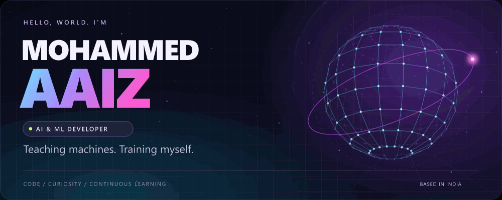
  </picture>

<h3 align="center">Artificial Intelligence &nbsp;✦&nbsp; Machine Learning &nbsp;✦&nbsp; Computer Vision</h3>

  <b>Turning curiosity into code, one experiment at a time.</b> 
  Learning how intelligent systems work — and how to make them useful.

  <a href="https://github.com/Mohammed-Aaiz?tab=repositories">Explore my repositories ↗</a>
  &nbsp;&nbsp;·&nbsp;&nbsp;
  <a href="mailto:aaizmoh9@gmail.com">Let's talk ↗</a>


  <picture><source media="(max-width: 600px)" srcset="https://raw.githubusercontent.com/Mohammed-Aaiz/Mohammed-Aaiz/main/assets/about-mobile.svg" />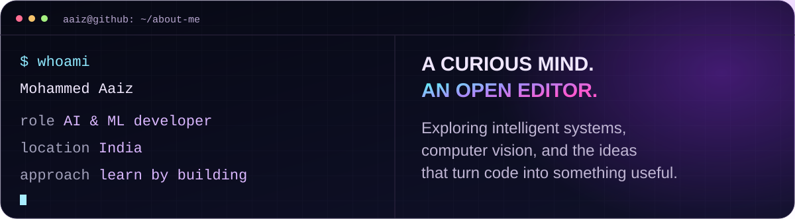</picture>


<table align="center">
<tr>
<td align="center" width="50%">
<h3>🧠 &nbsp; Intelligence &amp; data</h3>

Models, patterns, and a little experimentation.

  
  
  
  
  
  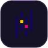

Python · PyTorch · TensorFlow scikit-learn · OpenCV · pandas · Seaborn
</td>
<td align="center" width="50%">
<h3>⚡ &nbsp; Software &amp; interfaces</h3>

From the logic underneath to the experience on top.

  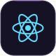
  
  
  

React · React Native · Node.js HTML · CSS
</td>
</tr>
<tr>
<td align="center">
<h3>🗃️ &nbsp; Behind the scenes</h3>

Giving applications a place to remember.

  
  
  

PostgreSQL · MongoDB · SQLite
</td>
<td align="center">
<h3>☁️ &nbsp; Workflow &amp; cloud</h3>

Versioning ideas. Exploring the cloud.

  
  

Git · AWS Learning Docker &amp; Kubernetes ↓
</td>
</tr>
</table>


<b>A little progress. A lot of pixels.</b> Watch the neon snake make its way through my GitHub contribution calendar.

  <a href="https://github.com/Mohammed-Aaiz?tab=overview">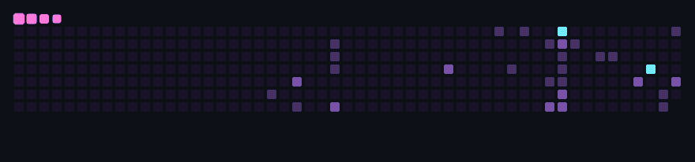</a>

Generated from my GitHub contribution calendar · Refreshed daily · <a href="https://github.com/Mohammed-Aaiz/Mohammed-Aaiz/actions/workflows/contributions.yml">View latest refresh ↗</a>


<b>The next chapter of my learning journey.</b> New tools. Better questions. More experiments.

  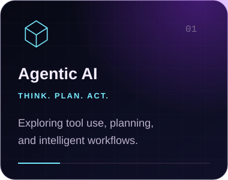
  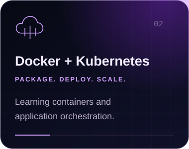
  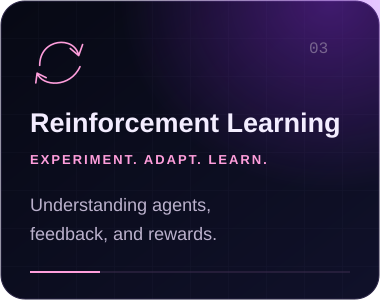

<b>↳ A closer look at what I'm exploring</b>

- **Agentic AI** — how models use tools, plan steps, and work through tasks.
- **Docker & Kubernetes** — packaging applications and understanding orchestration.
- **Reinforcement learning** — how agents learn from feedback and rewards.


  Interested in AI, swapping ideas, or building something together? 
  <b>My inbox is a good place to start.</b>

  
  
  
  

<a href="mailto:aaizmoh9@gmail.com">aaizmoh9@gmail.com</a>

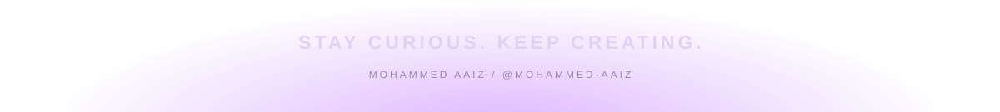

<!-- Technology icons: Devicon, MIT license; see assets/icons/LICENSE.txt. -->
