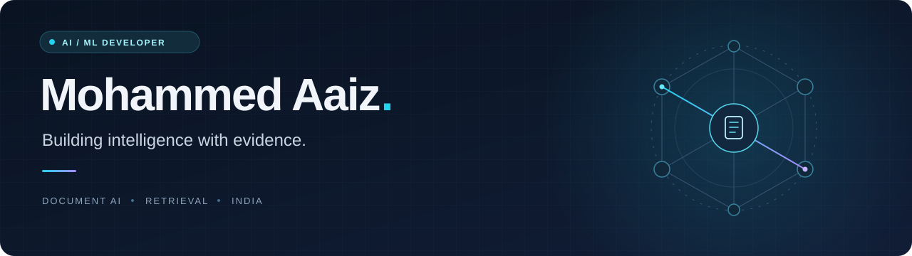

  

  
  
  

<h3 align="center">From documents to evidence. From ideas to working software.</h3>

I'm **Mohammed Aaiz**, an AI & ML developer from India. I'm interested in how machine learning, retrieval, and thoughtful product design come together to make useful software.

Right now, I'm building **DocuMind** and exploring a question that drives my work: **how can AI make its answers easier to trace back to the source?**

---

## Featured project · DocuMind

### Document intelligence, built around evidence.

[**DocuMind**](https://github.com/Mohammed-Aaiz/documind) is my document-intelligence and question-answering project. It brings document structure, semantic retrieval, and source-grounded answers into one workspace.

| Focus | What I'm building |
| :--- | :--- |
| **Understand the document** | Ingest PDF, DOCX, and TXT files while preserving useful document structure. |
| **Retrieve the evidence** | Combine semantic search with document structure and graph-based retrieval. |
| **Keep answers traceable** | Connect generated answers to their supporting source material. |
| **Support different workflows** | Separate Student and Research workspaces and conversations. |

**Project stack:** Python · FastAPI · PostgreSQL / pgvector · React · TypeScript · Groq

Actively developing. The project README documents current capabilities, setup, and known limitations.

---

## My toolkit

  
  
  
  
  
  

| Area | Languages & tools |
| :--- | :--- |
| **Programming** | Python, Java, C |
| **Machine learning & vision** | PyTorch, TensorFlow, scikit-learn, OpenCV |
| **Data analysis** | pandas, Seaborn |
| **Web & mobile** | React, React Native, Node.js, HTML, CSS |
| **Databases** | PostgreSQL, MongoDB, SQLite |
| **Cloud & version control** | AWS, Git |

## Currently exploring

- **Agentic AI** — tool use, planning, and workflows for AI applications.
- **Docker & Kubernetes** — packaging applications and understanding orchestration.
- **Reinforcement learning** — how agents learn through feedback and rewards.

---

## Let's connect

Have an idea around document AI, retrieval, or machine learning? I'd enjoy hearing about it.

**[LinkedIn](https://www.linkedin.com/in/mohammed-aaiz/)** · **[Kaggle](https://www.kaggle.com/mohammedaaiz)** · **[Email](mailto:aaizmoh9@gmail.com)** · **[Instagram](https://www.instagram.com/aaizmoh9/)**

Curious about intelligence. Careful about evidence. Always learning.

